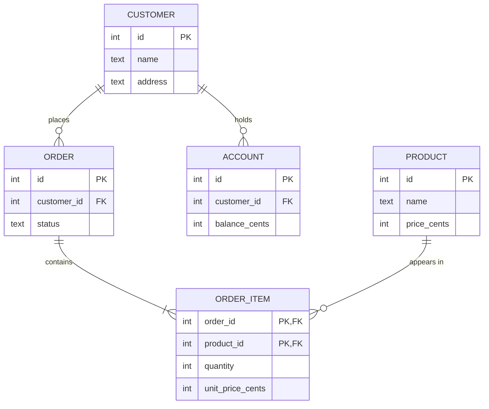

# Sample schema: order management

This is the worked example of the database design process: entities first, then tables, then a check that every fact lives in exactly one place. `docs/schema.sql` creates it, and every constraint below is enforced by the engine.

## Entities and relationships

An order line is its own entity because *order* and *product* are many-to-many: one order holds many products, and one product appears on many orders. A relational table cannot hold that directly, so the relationship becomes a table with a composite key.

## Functional dependencies

A functional dependency `X -> Y` says that any two rows agreeing on X must agree on Y. These are facts about the domain, so they are written down here rather than derived from the data.

| Table | Dependencies |
|---|---|
| `customers` | `id -> name, address` |
| `accounts` | `id -> customer_id, balance_cents` |
| `products` | `id -> name, price_cents` |
| `orders` | `id -> customer_id, status` |
| `order_items` | `(order_id, product_id) -> quantity, unit_price_cents` |

## Normal forms

**BCNF** requires that the left side of every non-trivial functional dependency is a key. BCNF implies 3NF, so it is the only check needed. Reading down the table, every left side above is that table's primary key, and no table has any other dependency, so **all five tables are in BCNF**.

It is worth checking the dependencies a skeptic would raise, because those are the design decisions that matter.

### Why `address` is on `customers` and not `orders`

If each order stored the customer's address, then `orders` would have `customer_id -> address`. `customer_id` is not a key of `orders`, so this violates BCNF, and more practically, changing an address would mean finding every order, and missing one leaves the database contradicting itself. Storing it once makes that impossible.

*The real question:* what about an order already shipped to an old address? If that history must be kept, then "address shipped to" is a different fact from "where the customer lives now" and would deserve its own column on `orders`. The sample assumes it is not needed.

### Why `unit_price_cents` is on `order_items`, which looks like a violation

It looks redundant, given `products.price_cents`. It is not, because they are different facts:

- `products.price_cents` is what the product costs **today**.
- `order_items.unit_price_cents` is what it cost **on that order**.

Prices change, and an old order's total must not. So `product_id -> unit_price_cents` does not hold: the same product has different prices on different orders. The attribute depends on the whole key `(order_id, product_id)`, and that is exactly what BCNF asks for.

### Why order totals are not stored

A total is derivable: the sum of `quantity * unit_price_cents` over an order's lines. Storing it as well would add `order lines -> total`, a fact held in two places that could drift apart. (There are no aggregates in this SQL subset, so an application computes it.)

### Why `city` and `postcode` are not separate columns

If `customers` held both, then `postcode -> city` would hold. `postcode` is not a key, so that is a transitive dependency and a classic 3NF violation. Fixing it needs a `postcodes` table. Keeping `address` as one attribute avoids this while keeping the sample small, and if a real system needed to query by city, that table would be the right next step.

## Keys and integrity

| Constraint | Enforced how |
|---|---|
| Every table has a primary key | The grammar-level translator refuses `CREATE TABLE` without one |
| Primary keys are unique and not NULL | Checked on insert under an exclusive row lock |
| A foreign key points at a row that exists | Checked under a shared lock on the parent, so it cannot be deleted before commit |
| A referenced row cannot be deleted | Refused (`RESTRICT`), under a shared lock on the child table, which also blocks a concurrent new child |

Money is stored as integer cents, never as a fraction, and arithmetic reports overflow instead of wrapping around.
