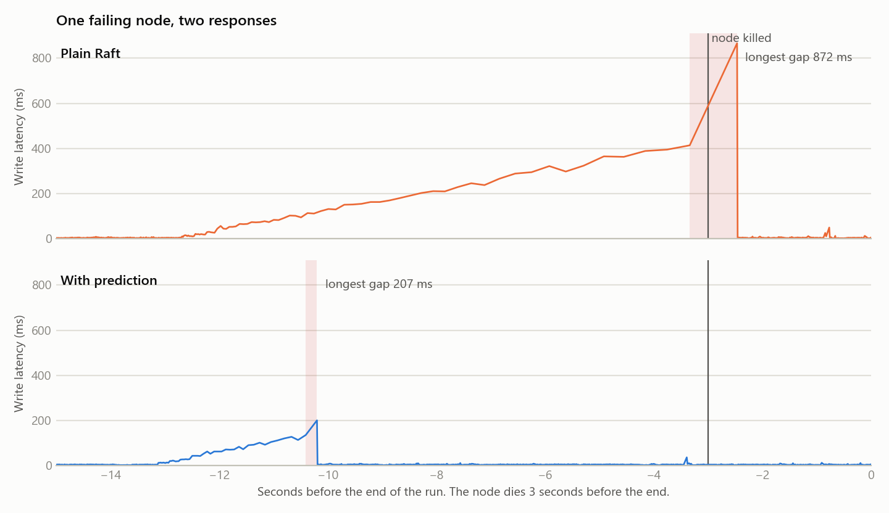
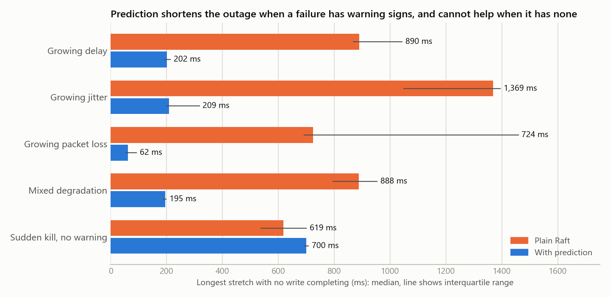

# Evaluation: does predicting failure help?

Real 5-node clusters of separate processes on one machine, with real fsync and mutual TLS. A client writes continuously throughout, and each trial pairs plain Raft with the predictor on the same fault. **Outage** means the longest stretch in which no write completed, as seen by the client, retries included.

240 trials, 10 to 10 per scenario per mode.

## Number 1: how much shorter is the outage?

| Failure | Plain Raft, median | With prediction, median | Change | 95% CI of the difference | Paired sign test p | Handed over before death |
|---|---:|---:|---:|---|---:|---:|
| Growing delay | 890 ms | 202 ms | -77% | -886 to -647 ms | 0.0020 | 10/10 |
| Growing jitter | 1,369 ms | 209 ms | -85% | -1,289 to -776 ms | 0.0020 | 10/10 |
| Growing packet loss | 724 ms | 62 ms | -91% | -1,635 to -590 ms | 0.0020 | 10/10 |
| Mixed degradation | 888 ms | 195 ms | -78% | -781 to -592 ms | 0.0020 | 10/10 |
| Sudden kill, no warning | 619 ms | 700 ms | +13% | -8 to +168 ms | 0.7539 | 0/10 |

Across all gradual failures: **910 ms** with plain Raft against **196 ms** with prediction. The predictor moved leadership before the death in 40 of 40 trials, a median of 4.6 s ahead of it.

### Tail latency while the node was getting worse

A failing leader hurts before it dies, so handing over early should help during that period as well.

| Failure | Plain Raft, p99 | With prediction, p99 |
|---|---:|---:|
| Growing delay | 362 ms | 106 ms |
| Growing jitter | 344 ms | 108 ms |
| Growing packet loss | 67 ms | 14 ms |
| Mixed degradation | 254 ms | 92 ms |

## Number 2: how often does it act when nothing is wrong?

A predictor could cut outages just by moving leadership around at random, so this number has to be read together with the first. In these scenarios the leader never fails, so any leadership change is unnecessary.

| Situation (leader stays healthy) | Trials per mode | Leader changes, plain Raft | Leader changes, with prediction | Trials with a false handover |
|---|---:|---:|---:|---:|
| Healthy | 10 | 0 | 0 | 0/10 |
| Brief latency blips | 10 | 0 | 0 | 0/10 |
| Steady slow network | 10 | 0 | 0 | 0/10 |
| Steady, very slow network | 10 | 0 | 0 | 0/10 |
| One bad follower link | 10 | 0 | 0 | 0/10 |
| One follower dies | 10 | 0 | 0 | 0/10 |
| Two followers die | 10 | 0 | 0 | 0/10 |

Over 13.9 minutes of no-failure operation in 70 trials, the predictor changed leader 0 time(s), against 0 for plain Raft.

Zero observed does not mean a rate of zero. With none in 70 trials, the 95% upper bound is about **4% of runs** (the rule of three), or about 13 per hour of these conditions. The data cannot rule out a rate below that, and these are conditions built to look like failure, not a quiet system. A real false-alarm rate would need far longer running than this project has done.

## Outside the training data

The scenarios above are fresh runs, but of the same kinds of fault the model trained on. These three were never in the training data, and answer the questions a score on familiar data cannot.

| Scenario | Trials per mode | Outage, plain Raft | Outage, with prediction | Handed over before death | Leader changes per trial, plain Raft / prediction |
|---|---:|---:|---:|---:|---:|
| Ramp over 25 s, much slower than training, then death | 8 | 828 ms | 660 ms | 4/8 | 1.0 / 1.0 |
| Ramp over 1.5 s, faster than the rule can act, then death | 8 | 884 ms | 806 ms | 0/8 | 1.0 / 1.0 |
| Same ramp as a real failure, but the node recovers | 8 | 376 ms | 206 ms | n/a (no death) | 0.0 / 1.0 |

## Reading these numbers

- **Plain Raft's outage depends on the election timeout.** These clusters use a timeout of 500 to 1000 ms, and the outage is close to that. With a longer timeout, plain Raft's outage grows in proportion, while the proactive path barely changes, as it does not wait for a timer. So the percentage is a statement about this configuration, not a constant. A timeout cannot simply be made tiny to avoid all this, because on a real network that causes needless elections.
- **All nodes share one machine.** Absolute latencies are not those of a real network. Comparisons between the two modes are the meaningful part.
- **The faults are injected.** A ramp of delay, jitter and loss stands in for a failing machine. Real hardware may degrade differently, or not gradually at all, so nothing here is a claim about how often real failures could be predicted.
- **Sign tests on 10 pairs bottom out at p = 0.002**, which is what all-10-pairs-agree gives. The effect is large enough that more trials would not change the conclusion, but they would tighten the intervals.
